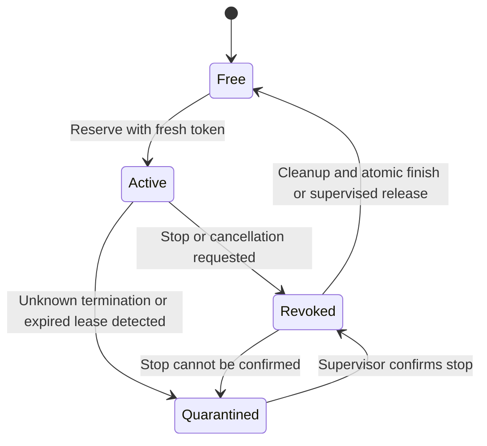

# Fixture execution boundaries

Birbforge will call Verify activities from its own Temporal workflow.
`FixtureWorkflow` exists only to exercise that activity. It neither admits
factory actions nor implements an environment queue.

The fixture target service runs in a separate process. It alone opens the
SQLite target database. Worker processes use a private Unix socket. The exact
exercised mutation boundary is `Target.call("apply")`. It performs
`BEGIN IMMEDIATE`, validates owner token, active state and deadline, checks the
immutable request and operation payload, and commits the counter update,
observed candidate and operation receipt in the same transaction.

Every reservation gets a fresh random token. Tokens are never reissued. Revoke
changes state within that database. An expired lease denies writes but retains
ownership. A successor sees busy until confirmed stop, cleanup and release.
Unknown termination changes the reservation to quarantined. The fixture
supervisor confirms a killed process with `wait`, checks owned Docker containers
when relevant, records an immutable terminal manifest, resets the synthetic
target, then explicitly releases ownership. Supervised release refuses an
attempt without its terminal manifest, including after confirmed cleanup.
A worker token cannot lift quarantine. Recovery requires a separate synthetic
supervisor capability. It is not a production operator authentication system.
There is no automatic takeover timer. Canonical manifest publication and release
commit together in the target's owner-checked finish transaction. A duplicate
reservation returns that terminal result, including after cleanup.

A receipt read works after revocation and checks the operation parameters.
A missing receipt is not proof that no effect occurred. Repeating the same
stable operation ID reaches the same transactional uniqueness check, so even a
delayed original and a concurrent repeated call produce one effect. This is
specific to the transactional fixture effect. It does not justify blindly
repeating a deployment on another system. Such an adapter needs its own receipt
and reconciliation boundary, or quarantine when the answer remains unknown.

Direct worker file writes under an advisory lock were rejected. Lock release
on process death cannot establish that another process stopped. An advisory
lock also cannot revoke a writer at the target's transactional boundary.

The fixture supervisor capability is an owner-only random file. Worker
configuration contains only its digest, and the observation/inspection projection
never includes a reservation token. Shared-UID malicious access to that file is
outside this fixture trust model.

Candidate checks execute in a digest-pinned Python image. The Docker container
has no network, capabilities, credentials, target socket, Docker socket or host
configuration. It runs as UID 65534 with a read-only root and candidate mount,
no-new-privileges, 32 PIDs, 128 MiB and one CPU. Only the approved procedure and
synthetic data enter the mount. Output is bounded to 64 KiB. The known container
name derives from the attempt ID before creation. Cancellation waits for the
create command to settle and forced removal plus not-found inspection before
acknowledging stop. Worker SIGKILL cannot execute that cleanup, so the
reservation stays retained or quarantined for the supervisor.

This demonstrates cooperative worker fencing and candidate credential exclusion
on one Linux Docker host. Trusted fixture supervisors share a Unix UID and
root-equivalent Docker access. They could bypass the service or modify files.
The fixture does not establish isolation from a malicious host worker, a
compromised Docker daemon, or a kernel escape. Native Mac isolation, deployed
k3s fencing, cross-node clocks, production identity, retention and storage access
controls require separate implementation and acceptance.

The code is organized by domain. `contract.py` owns immutable wire shapes and
evidence eligibility. `policy.py` owns the fixture installation allowlist.
`target.py` owns the target mutation transaction and durable execution receipts.
`runner.py` owns exact-source checks and private artifacts. `temporal_worker.py`
is the supported SDK adapter. `projection.py` is the AG-UI read projection.
`fixture.py` and the tests own disposable setup and process interruption.
Execution receipts are not authored work records. Beans owns the authored
milestone issue, shared notes and handoff.

